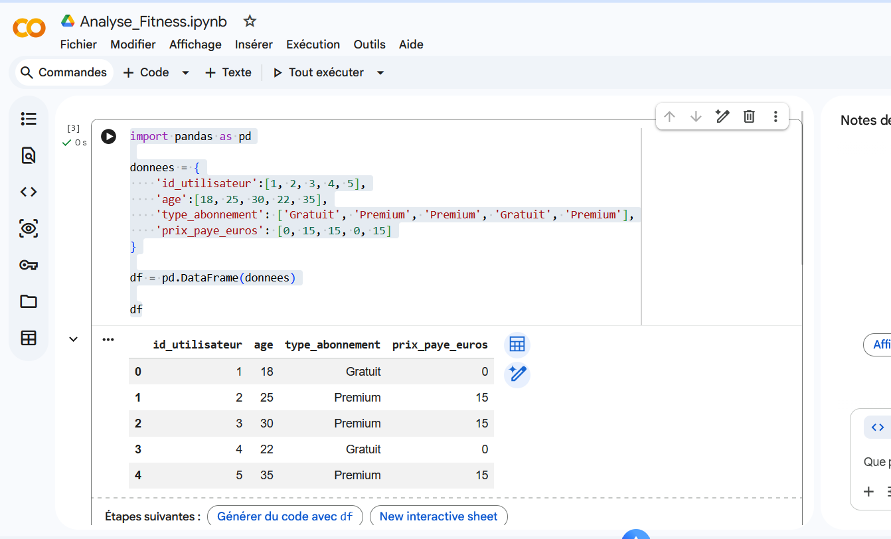
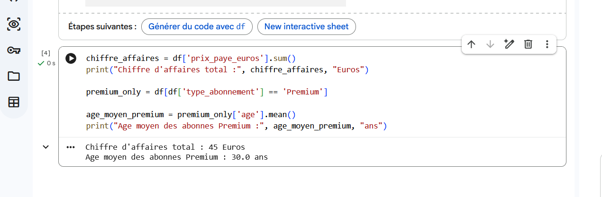

# Analyse-Fitness-Python
# Analyse des abonnements d'une application mobile (Fitness)

## Contexte Metier
Ce projet simule le role d'un Data Analyst pour une application mobile de sport et bien-etre. L'objectif est d'analyser un extrait de la base de donnees des abonnements pour calculer le chiffre d'affaires global genere et identifier le profil sociodemographique (age moyen) des clients convertis aux offres payantes, afin d'optimiser les prochaines campagnes publicitaires.

## Stack Technique
* Environnement : Google Colab (Notebook)
* Langage : Python
* Bibliotheque : Pandas (Manipulation et analyse de structures de donnees)

## Logique du Script Python
Le script integre la bibliotheque Pandas pour modeliser un DataFrame. Il utilise la fonction .sum() pour agreger l'ensemble des revenus, applique un filtre logique pour isoler la population cible, puis utilise la fonction .mean() pour calculer l'age moyen de ce segment specifique.

## Conclusions du Projet
L'analyse demontre un chiffre d'affaires cumule de 45 EUR sur l'echantillon et etablit l'age moyen des utilisateurs de l'abonnement Premium a 30 ans. Ces metriques indiquent que le coeur de cible marketing se situe sur le segment des trentenaires actifs.

### Appercu de la table clients

### Analyse concernant les clients premium

